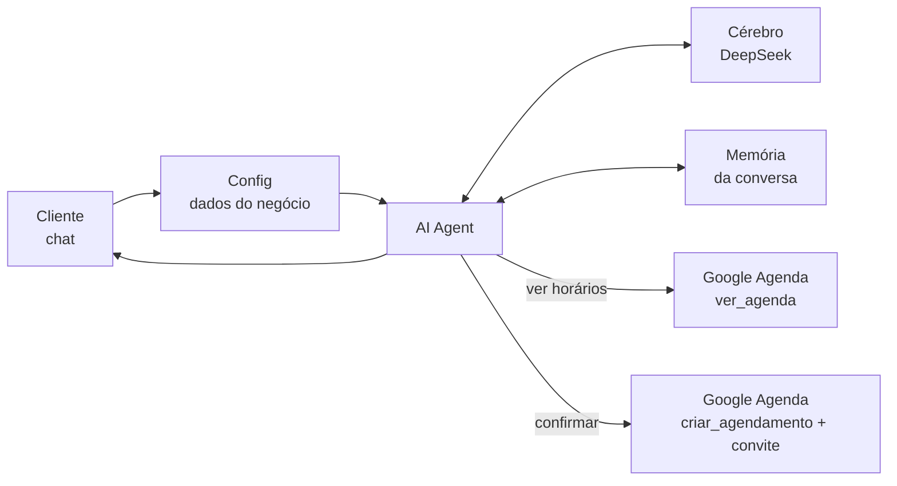

# Jabuticaba

Agente de IA que atende as clientes de um salão de beleza por chat (WhatsApp), indica o serviço certo e marca o horário no Google Agenda.

Trabalho de ACSO (Sistemas Autônomos, FAETEC de Quintino), tema **"Criando um agente autônomo de IA"**. Entrega até **24/10**, grupo de até 4 alunos. Tema escolhido do roteiro do professor: **Agente de Agendamento por WhatsApp**, com a triagem e o pré-agendamento do Tema 3 aplicados a um salão de beleza fictício, o Salão Jabuticaba.

## O que o professor pede

**Entregáveis**
- [ ] Vídeo mostrando o agente funcionando
- [ ] Apresentação em PowerPoint
- [ ] Documento Word com o diagrama de operações e a descrição

**O que o documento precisa ter** (rascunho pronto em [docs/relatorio.md](docs/relatorio.md))
- [ ] Escopo do problema real e restrito
- [ ] Objetivos gerais e específicos
- [ ] Justificativa da pilha tecnológica
- [ ] Tipo de abordagem: no-code vs. low-code, com vantagens, desvantagens e justificativa
- [ ] Etapas: Definição do Problema, Prompt Base, Base de Dados (RAG), Ferramentas/APIs, Testes e Refinamento
- [ ] Engenharia de prompt: papel, limites e regras de saída
- [ ] Alimentação de dados
- [ ] Configuração das integrações (webhooks, chaves de API)
- [ ] Camada de avaliação: taxa de acerto, tempo de execução, segurança dos dados
- [ ] Diagrama de blocos: Interface (Chat) → Cérebro (LLM) → Tomada de Decisão → Execução da Ferramenta

## O que o agente faz

1. A cliente escreve no chat: "quero cobrir meus fios brancos, tem horário sábado?".
2. O agente faz a triagem: entende que é Coloração, com a Juliana, 2 horas, R$ 180.
3. Se for a primeira química, ele avisa do teste de alergia 48 horas antes.
4. Ele consulta os horários livres da semana no Google Agenda e oferece opções que caibam na duração do serviço.
5. Quando a cliente confirma, ele cria o evento e o Google envia o convite por e-mail.

## O MVP: uma aplicação customizável

O agente é dividido em duas partes:

- **Parte genérica (não muda):** o fluxo do n8n e o prompt. Eles não sabem que é um salão.
- **Parte do negócio (muda para cada cliente):** o nó **Config** do fluxo, com nome, serviços, preços, profissionais e regras.

Para atender uma barbearia ou um estúdio de unhas, basta preencher [negocios/modelo.md](negocios/modelo.md) e colar no Config. O primeiro caso é o salão: [negocios/salao.md](negocios/salao.md).

| Peça | Para que serve | Custo |
|---|---|---|
| **n8n Cloud** | Monta o agente com blocos (low-code) | Teste grátis de 14 dias |
| **DeepSeek** | O cérebro: entende a mensagem e decide qual ferramenta usar | Centavos |
| **Google Agenda** | Ver horários e criar o atendimento com convite por e-mail | Grátis |
| **Evolution API** | Liga um número de WhatsApp ao n8n | Grátis (fica para depois do MVP) |

**O que fica fora do MVP, de propósito:** WhatsApp de verdade (o chat do n8n simula a conversa), cancelamento e remarcação, lembretes e painel para o dono do negócio.

## Como rodar o MVP

### 1. Criar as contas
1. **n8n Cloud:** criar conta em [n8n.io](https://n8n.io) (teste grátis).
2. **DeepSeek:** criar conta em [platform.deepseek.com](https://platform.deepseek.com), colocar uns poucos reais de crédito e gerar uma chave de API.
3. **Google:** usar uma conta Gmail de teste. No Google Agenda, criar uma agenda chamada "Salão Jabuticaba" (opcional, pode usar a principal).

### 2. Importar o fluxo
1. No n8n, criar um workflow novo, clicar nos três pontinhos e em **Import from File**.
2. Escolher o arquivo [n8n/agente-agendamento.json](n8n/agente-agendamento.json).

### 3. Ligar as credenciais
1. Abrir o nó **DeepSeek** e criar a credencial colando a chave de API.
2. Abrir o nó **ver_agenda**, criar a credencial do Google (Sign in with Google) e escolher a agenda.
3. Abrir o nó **criar_agendamento**, usar a mesma credencial e a mesma agenda.

### 4. Testar
1. Clicar em **Open chat** e conversar: "oi, quero cobrir meus fios brancos, tem horário sábado?".
2. Conferir o evento no Google Agenda e o convite no e-mail usado na conversa.
3. Na aba **Executions** dá para ver cada passo que o agente tomou e quanto tempo levou.

### Alternativa: n8n local
Com o Docker Desktop instalado: `docker run -it --rm -p 5678:5678 -v n8n_data:/home/node/.n8n docker.n8n.io/n8nio/n8n` e abrir `http://localhost:5678`. O fluxo importa igual. A diferença é que a conta Google exige criar um projeto no Google Cloud com OAuth, e o WhatsApp exige um endereço público.

## Plano até a entrega

- **Dia 1 (22/10):** criar as contas, importar o fluxo, conversar com o agente. **Aprende:** o que é LLM, prompt, token, memória e por que a IA "alucina".
- **Dia 2 (23/10):** ligar o Google Agenda, rodar os 10 testes de [docs/relatorio.md](docs/relatorio.md#7-camada-de-avaliação) e ajustar o prompt. **Aprende:** a diferença entre chatbot e agente: o agente decide sozinho quando usar cada ferramenta.
- **Dia 3 (24/10):** gravar o vídeo (2 a 3 minutos mostrando o fluxo, uma conversa e o evento na agenda), passar o relatório para o Word e montar o PowerPoint.

### Depois do MVP: WhatsApp de verdade
Subir a Evolution API, ler o QR Code com um chip de teste, apontar o webhook para o n8n e trocar o gatilho de chat por um **Webhook** + **HTTP Request** para responder. Use um número de teste: a Evolution usa o WhatsApp Web, que não é a API oficial, e o número pode ser bloqueado.

## Pensando em produto (depois do trabalho)

Como o fluxo já é genérico, cada novo cliente (salão, barbearia, estúdio de unhas, clínica de estética) é só um novo Config, um número de WhatsApp e uma agenda. Para não pagar o n8n Cloud por cliente, o caminho é levar o fluxo para um n8n próprio em um servidor barato.

## Cuidados

- Nunca suba chaves de API para o GitHub.
- Não use dados reais de clientes nos testes.
