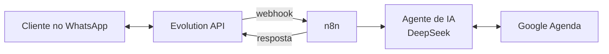

# Jabuticaba

Agente de IA que conversa pelo WhatsApp e marca compromissos no Google Agenda.

Trabalho de ACSO (FAETEC) sobre Agentes de IA. A ideia é aprender montando, peça por peça, e deixar a base pronta para virar produto no futuro.

## O que o agente faz

1. Alguém manda uma mensagem no WhatsApp: "quero marcar um horário amanhã às 15h".
2. O agente entende o pedido com IA.
3. Ele consulta a agenda, cria o evento no Google Agenda e responde confirmando.

## Arquitetura

| Peça | Para que serve | Custo |
|---|---|---|
| **Evolution API** | Liga um número de WhatsApp ao sistema (lê QR Code, recebe e envia mensagens) | Grátis, roda no seu PC ou servidor |
| **n8n** | Monta o fluxo arrastando blocos, sem precisar programar tudo | Grátis na versão self-hosted |
| **DeepSeek** | O "cérebro": entende a mensagem e decide o que fazer | Centavos por milhares de mensagens |
| **Google Agenda** | Onde os eventos ficam salvos | Grátis |
| **Docker** | Roda a Evolution API e o n8n no computador com um comando | Grátis |

Por que essas escolhas: são baratas, populares no Brasil (muito tutorial em português) e o n8n já tem blocos prontos para DeepSeek, Google Agenda e webhooks.

## Passo a passo de aprendizado

Cada etapa termina com algo funcionando. Só avance quando a anterior estiver ok.

### Etapa 1: Preparar o ambiente
- Instalar o Docker Desktop.
- Subir o n8n e abrir `http://localhost:5678`.
- **Aprende:** o que é um container e o que é uma automação.

### Etapa 2: Primeiro fluxo no n8n
- Criar um fluxo com o bloco **Webhook** e testar mandando uma mensagem pelo navegador ou Postman.
- **Aprende:** gatilho, nós, e como os dados passam de um bloco para outro (JSON).

### Etapa 3: Conectar a IA
- Criar conta na DeepSeek e gerar uma chave de API (colocar uns poucos reais de crédito basta).
- No n8n, usar o bloco **AI Agent** com o modelo **DeepSeek Chat**.
- Escrever um prompt de sistema simples: "Você é um assistente que agenda horários...".
- **Aprende:** o que é um LLM, prompt, token e por que custa dinheiro.

### Etapa 4: Conectar o WhatsApp
- Subir a Evolution API, criar uma instância e ler o QR Code com um celular (de preferência um chip de teste).
- Configurar o webhook da Evolution para chamar o n8n quando chegar mensagem.
- No final do fluxo, usar um bloco **HTTP Request** para mandar a resposta de volta.
- **Aprende:** API, webhook, e o caminho de ida e volta de uma mensagem.

### Etapa 5: Conectar o Google Agenda
- Criar credenciais no Google Cloud e ligar no n8n.
- Dar ao agente duas ferramentas: **ver horários livres** e **criar evento**.
- **Aprende:** o que torna um "agente" diferente de um chatbot: ele decide usar ferramentas.

### Etapa 6: Memória e acabamento
- Adicionar memória de conversa (o agente lembra do que foi dito antes).
- Tratar casos simples: horário ocupado, mensagem que não é sobre agenda.
- Gravar um vídeo curto mostrando funcionando para a apresentação.

## Pensando em produto (para depois do trabalho)

Não precisa fazer agora, mas a arquitetura já permite:
- Um número de WhatsApp e uma agenda por cliente (ex.: barbearia, clínica, personal).
- Hospedar em um servidor barato (VPS) em vez do PC.
- Cobrar mensalidade pelo atendente automático.

## Cuidados

- Use um número de WhatsApp de teste. A Evolution API usa o WhatsApp Web, que não é a API oficial, e o número pode ser bloqueado se mandar muita mensagem.
- Nunca suba chaves de API para o GitHub.
