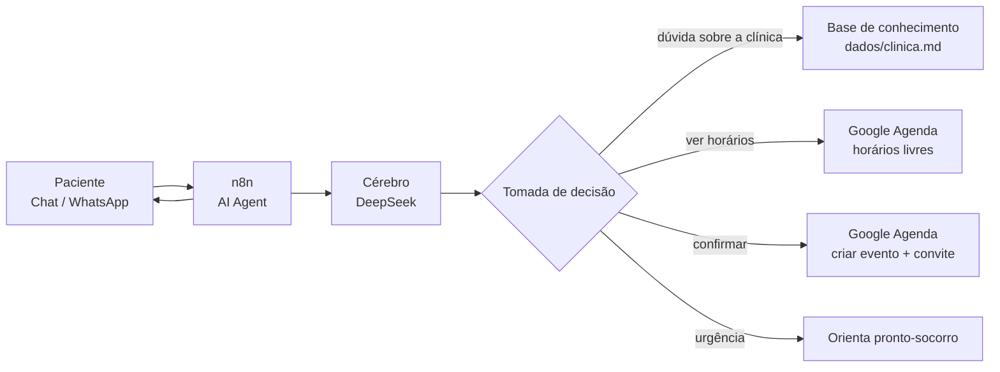

# Jabuticaba

Agente de IA que faz a triagem e o pré-agendamento de consultas de uma clínica, conversando por chat (WhatsApp) e marcando no Google Agenda.

Trabalho de ACSO (Sistemas Autônomos, FAETEC), tema **"Criando um agente autônomo de IA"**. Entrega até **24/10**, grupo de até 4 alunos. Tema escolhido do roteiro do professor: **Tema 3, Agente de Triagem e Pré-Agendamento de Consultas** (é o mesmo do "Agente de Agendamento por WhatsApp" da lista individual).

## O que o professor pede

**Entregáveis**
- [ ] Vídeo mostrando o agente funcionando
- [ ] Apresentação em PowerPoint
- [ ] Documento Word com o diagrama de operações e a descrição

**O que o documento precisa ter** (rascunho pronto em [docs/relatorio.md](docs/relatorio.md))
- [ ] Escopo do problema real e restrito
- [ ] Objetivos gerais e específicos
- [ ] Justificativa da pilha tecnológica
- [ ] Tipo de abordagem: no-code vs. low-code, com vantagens, desvantagens e justificativa
- [ ] Etapas: Definição do Problema, Prompt Base, Base de Dados (RAG), Ferramentas/APIs, Testes e Refinamento
- [ ] Engenharia de prompt: papel, limites e regras de saída
- [ ] Alimentação de dados
- [ ] Configuração das integrações (webhooks, chaves de API)
- [ ] Camada de avaliação: taxa de acerto, tempo de execução, segurança dos dados
- [ ] Diagrama de blocos: Interface (Chat) → Cérebro (LLM) → Tomada de Decisão → Execução da Ferramenta

## O que o agente faz

1. O paciente escreve no chat: "estou com dor no peito quando corro, queria marcar uma consulta".
2. O agente pergunta o motivo e faz a triagem: Clínico Geral, Cardiologista ou Dermatologista.
3. Ele consulta os horários livres da semana no Google Agenda e oferece opções.
4. Quando o paciente confirma, ele cria o evento e o Google envia o convite por e-mail para o paciente e para a clínica.
5. Se for urgência (ex.: dor forte no peito agora), ele não agenda e orienta procurar o pronto-socorro.

## Arquitetura

| Peça | Para que serve | Custo |
|---|---|---|
| **n8n** | Monta o agente arrastando blocos (low-code) | Grátis (self-hosted) |
| **DeepSeek** | O cérebro: entende a mensagem e decide qual ferramenta usar | Centavos |
| **Google Agenda** | Ver horários livres e criar a consulta com convite por e-mail | Grátis |
| **Evolution API** | Liga um número de WhatsApp ao n8n | Grátis (opcional, ver abaixo) |
| **Docker** | Roda o n8n (e a Evolution) no PC com um comando | Grátis |

## Plano para os 3 dias

O próprio Tema 3 diz "simulando um chat de WhatsApp". Por isso o plano usa primeiro o **chat do próprio n8n**, que já funciona sem configurar nada. O WhatsApp de verdade fica como bônus se sobrar tempo.

### Dia 1 (21–22/10): agente conversando
1. Instalar o Docker Desktop e subir o n8n: `docker run -it --rm -p 5678:5678 -v n8n_data:/home/node/.n8n docker.n8n.io/n8nio/n8n` e abrir `http://localhost:5678`.
2. Criar conta na DeepSeek, colocar uns poucos reais de crédito e gerar a chave de API.
3. No n8n: bloco **When chat message received** → bloco **AI Agent** com modelo **DeepSeek Chat** e **Simple Memory**.
4. Colar o prompt de [prompts/prompt-base.md](prompts/prompt-base.md) no campo "System Message" do AI Agent.
5. Conversar pelo botão "Open chat" e ver a triagem funcionando.

**Aprende:** o que é LLM, prompt, token, memória e por que a IA "alucina".

### Dia 2 (22–23/10): ferramentas
1. Criar uma agenda "Clínica Jabuticaba" no Google Agenda e ligar a conta Google no n8n.
2. Adicionar no AI Agent duas ferramentas **Google Calendar Tool**: uma para ver eventos da semana (horários ocupados) e outra para criar evento com o e-mail do paciente como convidado.
3. Criar um Google Docs com o texto de [dados/clinica.md](dados/clinica.md) e adicionar a ferramenta **Google Docs Tool** para ler esse documento (é a nossa base de conhecimento, um RAG simplificado).
4. Testar os casos da tabela em [docs/relatorio.md](docs/relatorio.md#7-camada-de-avaliação) e anotar os resultados.

**Aprende:** a diferença entre chatbot e agente: o agente decide sozinho quando usar cada ferramenta.

### Dia 3 (23–24/10): entrega
1. Gravar o vídeo (2 a 3 minutos): mostrar o fluxo no n8n, uma conversa completa e o evento aparecendo na agenda e o convite no e-mail.
2. Completar [docs/relatorio.md](docs/relatorio.md) com os resultados dos testes e passar para o Word com prints.
3. Montar o PowerPoint usando as mesmas seções do relatório.

### Bônus: WhatsApp de verdade
Subir a Evolution API, ler o QR Code com um chip de teste, apontar o webhook para o n8n e trocar o gatilho de chat por um **Webhook** + **HTTP Request** para responder. Use um número de teste: a Evolution usa o WhatsApp Web, que não é a API oficial, e o número pode ser bloqueado.

## Pensando em produto (depois do trabalho)

A mesma base serve para vender um "atendente automático" para clínicas, barbearias e escritórios: um número de WhatsApp, uma agenda e uma base de conhecimento por cliente, rodando em um servidor barato.

## Cuidados

- Nunca suba chaves de API para o GitHub.
- Não use dados reais de pacientes nos testes.
